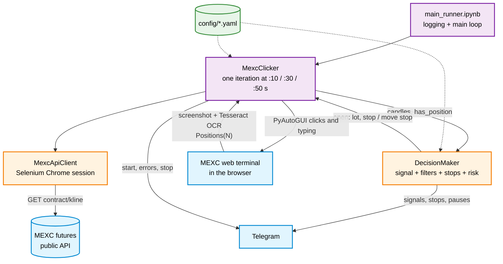

# MEXC futures clicker bot


A trading bot for MEXC USDT-margined futures (default `ADA_USDT`, 5-minute candles).
It takes candles from the public MEXC futures API, decides on entries and stops
with a set of candle filters, and trades by **clicking the MEXC web interface**:
it moves the mouse and types into the order form, and reads the open-positions
counter from the screen with OCR. No private API key is used.

## Architecture



## Repository layout

```
main_runner.ipynb                 — entry point: logging, Telegram notifier, DecisionMaker, MexcClicker, main loop
modules/
  config_base.py                  — BaseConfigLoader: loads all config/*.yaml into attributes
  mexc_api_client.py              — MexcApiClient: candles from futures.mexc.com/api/v1/contract/kline via a persistent Chrome session
  decision_maker.py               — DecisionMaker: entry signal, filters, stop logic, risk management, lot size
  mexc_clicker.py                 — MexcClicker: main iteration, clicks/typing in the web terminal, OCR of the positions counter
  notifier.py                     — TelegramNotifier (Notifier interface)
  utils.py                        — TradingUtils: price precision helpers
config/
  decision_config.yaml            — strategy: signal timing, filters, stops, position size, loss limits
  mexc_clicker_config.yaml        — symbol and timeframe, API refresh seconds, OCR settings, screen coordinates of every control
  telegram_config.yaml            — Telegram bot token and chat id (placeholders in the repository)
layout/
  mexc_screen_checklist.txt       — how the OS, browser and MEXC page must be set up before a run
  mexc_screen_mini_pc.jpg         — reference screenshot of the expected screen layout
adhoc/
  screen_coord_detection.ipynb    — helper for finding screen coordinates of the controls
```

## Secrets

`config/telegram_config.yaml` contains placeholders instead of real values:
`YOUR_TELEGRAM_BOT_TOKEN` and `YOUR_TELEGRAM_CHAT_ID`. Fill them in on the
machine the bot runs on and do not commit the filled-in file. The bot does not
use MEXC API keys: it trades through the browser session you are logged in to.

## How it works

`MexcClicker.run_loop()` runs one iteration at the seconds listed in
`API.REFRESH_INTERVALS_SECONDS` (10, 30, 50 by default). Each iteration:

1. Checks the screen for the MEXC "suspicious activity" pop-up; if it is there,
   sends a Telegram alert and stops the bot.
2. Loads the last `NUM_CANDLES_TO_FETCH` candles (121) from the public futures
   kline API. The request goes through a persistent Selenium Chrome session,
   which is faster and less likely to be blocked than plain HTTP.
3. Reads the number of open positions from the "Positions(N)" tab with Tesseract
   OCR.
4. Passes candles, the position flag and the time left to the candle close to
   `DecisionMaker.check_signal_and_risk()`, which returns either "open a long
   with this lot and stop", "move the stop to this price" or nothing.
5. Carries out the decision by clicking and typing in the order form: lot in
   USD, stop price, Open Long; or the TP/SL edit form to move the stop.

### Entry signal (long only)

A signal is checked only in the last `ENTRY_TIME_OFFSET_SEC` seconds (10) of a
candle. The current candle must be green and pass all filters:

- **Volatility** — the signal candle body must be at least `BODY_MIN_POINTS`
  price steps and not abnormally large (above the 95th percentile of the last
  bodies), and the previous candle must not be abnormally large either. A large
  body still passes if it is within `MAX_BODY_RATIO` of the period maximum.
- **Zig-zag** — the previous candle must be red, or an abnormally small green
  candle that follows a red one.
- **Trend** — slope of WMA(20) over the last 5 candles must not be steeper than
  `WMA_ANGLE_LIMIT` degrees down.
- **Flat** — rejects entries inside a sideways range built from the last 8
  candles (percentile borders, balance coefficient, allowed breakouts).

### Stops

The initial stop is set from the signal candle. While a position is open the
stop is moved near the candle close (`TRAILING_UPDATE_TIME_OFFSET_SEC`), or at
once if the price falls below the entry while the stop is not yet at breakeven.
The trailing logic moves the stop by a share of the accumulated distance, to
breakeven after a profit of one signal-candle body or after
`BREAKEVEN_IDLE_CANDLES` idle candles, and handles large adjacent candles.

### Risk management

- Position size: fixed margin (`FIXED_MARGIN_USD`) times leverage
  (`LEVERAGE_FACTOR`).
- After `MAX_CONSECUTIVE_LOSS_DEALS` losing trades in a row (losses below
  `INITIAL_STOP_SENSITIVE_LEVEL` of the initial stop are ignored) the bot pauses
  for `BREAK_DURATION_SHORT_MINUTES`.
- Accumulated margin loss: `MARGIN_LOSS_LIMIT_PAUSE` (5%) pauses trading,
  `MARGIN_LOSS_LIMIT_HALT` (30%) stops it.

Every signal, stop move, pause and error is sent to Telegram.

## Running

The bot drives a real screen, so it needs a desktop machine (Windows was used)
that stays on and unlocked.

1. Install Python packages: `selenium`, `pyautogui`, `pytesseract`,
   `opencv-python`, `numpy`, `pyyaml`, `requests`, plus Jupyter.
2. Install [Tesseract OCR](https://github.com/tesseract-ocr/tesseract) and set
   `OCR.TESSERACT_PATH` in `config/mexc_clicker_config.yaml`.
3. Install Google Chrome (used by Selenium for candle data).
4. Open the MEXC futures page and set it up exactly as in
   `layout/mexc_screen_checklist.txt` and `layout/mexc_screen_mini_pc.jpg`:
   browser zoom 75%, the right coin and timeframe, Isolated margin, 10x leverage,
   lot in USDT, TP/SL enabled, the Positions tab open, and so on.
5. If your screen differs, find new coordinates with
   `adhoc/screen_coord_detection.ipynb` and update `TRADE_PANEL`,
   `TP_SL_ADD_FORM_*` and `POPUP_CONFIRMATION` in `mexc_clicker_config.yaml`.
6. Fill in `config/telegram_config.yaml`.
7. Open `main_runner.ipynb` and run the cells. The loop starts after a 15-second
   pause, which is the time to switch to the MEXC browser tab. Do not touch the
   mouse or the screen while the bot is running.

Logs are written to `log/` (ignored by git).
